<p align="center">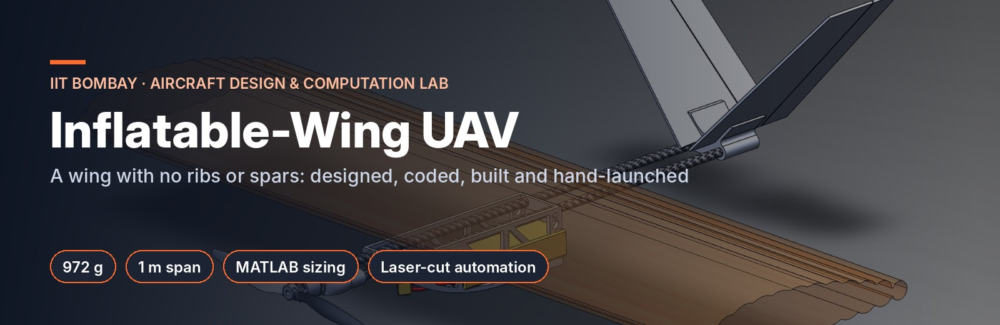</p>

<p align="center">


</p>

# Inflatable-Wing UAV — Design, Sizing & Fabrication

**Aircraft Design and Computation Lab, Dept. of Aerospace Engineering, IIT Bombay** · Research Intern under Prof. R. K. Pant · Jun – Aug 2026

A fixed-wing UAV whose wing has **no ribs or spars**: it is a pressurised film envelope that only takes its airfoil shape once inflated. I designed the aircraft end to end: sizing code, CAD, laser-cut file generation, fabrication and testing.

<p align="center">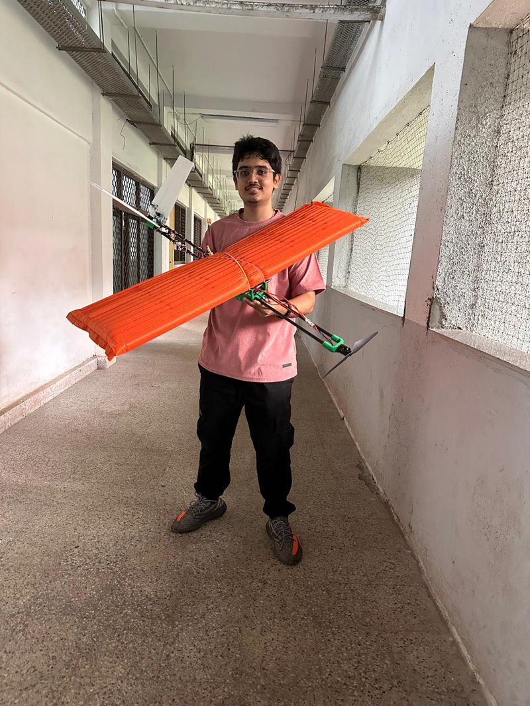 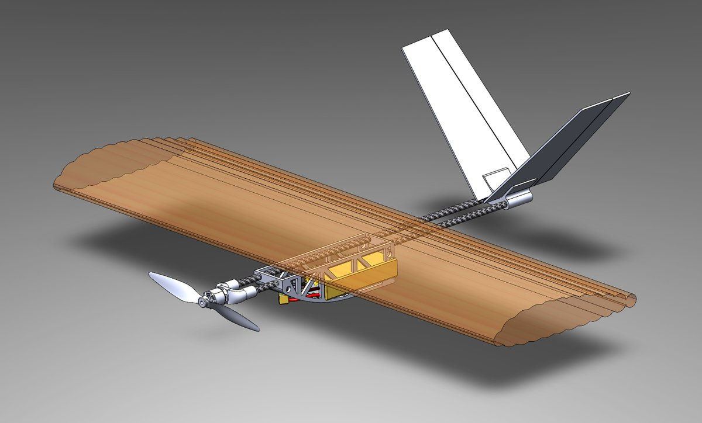</p>

| | |
|---|---|
| Wing | 1.0 m span × 0.3 m chord, AR 3.3, inflatable NACA 4318 (baffled) |
| Tail | V-tail, 5 mm Depron |
| Structure | 3D-printed fuselage, motor mount & tail mount, twin carbon-fibre booms |
| All-up mass | **972 g**, hand-launched |
| Design targets | 8.5 m/s stall (15 % wing-loading margin), > 30 min endurance, T/W ≥ 0.30 |
| Wings built | 8 (3 LDPE, 5 nylon) |

---

## 1. Sizing & constraint analysis (MATLAB)

[`matlab/sizing/uav_sizing.m`](matlab/sizing/uav_sizing.m) is an interactive sizing tool. Press Enter at any prompt to accept the default; the defaults reproduce the baseline aircraft.

- **Gross-weight convergence:** iterates W₀ from a component mass list. Only wing mass scales with W₀ through area. Wing areal mass is calibrated from a wing that was actually built and weighed.
- **Wing loading** comes from the 8.5 m/s stall boundary with a 15 % margin. Air density follows the ISA troposphere model at operating altitude.
- **Cruise sweep (10–15 m/s):** C_L, C_D, L/D, power required, motor power and endurance at each speed. Each speed is flagged for stall, thrust, power or endurance limits.
- **Propulsion:** loaded RPM, pitch speed and slip. Static thrust comes from momentum theory with a figure of merit, which gives the *available* T/W to check against hand-launch, cruise and climb requirements.
- **Tail sizing** uses volume coefficients. **Longitudinal stability** gives the neutral point, CG and static margin.
- **Plots:** constraint (matching) chart, cruise-performance panel and weight-breakdown pie.

[`matlab/sizing/uav_layout_solver.m`](matlab/sizing/uav_layout_solver.m) then solves the layout. It sweeps tail moment arm, wing station and V-tail dihedral, places the battery to hit a target static margin, rejects infeasible layouts and keeps the **shortest feasible aircraft**.

Every equation is written out in [`docs/FORMULAS.md`](docs/FORMULAS.md), with the program flow in [`docs/flowchart.png`](docs/flowchart.png).

## 2. Automated laser-cut files (MATLAB → DXF)

Before this, every skin and baffle panel was drawn and cut by hand. I wrote two generators that turn the output of the lab's existing inflated-airfoil converter (NACA 4318 → bumpy inflated geometry for a given chord and span) into ready-to-cut layered DXF files:

- [`skin_to_dxf.m`](matlab/laser-cut/skin_to_dxf.m): upper and lower skin panel with leading-edge centreline, edge cuts and sealing-line offsets
- [`baffle_to_dxf.m`](matlab/laser-cut/baffle_to_dxf.m): every baffle as a band with gaps and borders, scaled to any chord and span

<p align="center">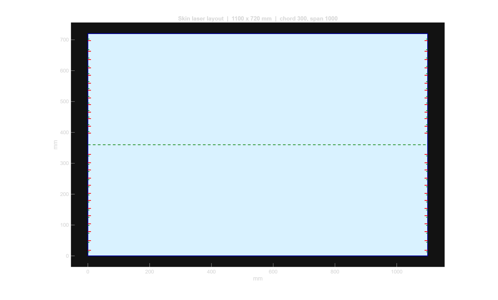 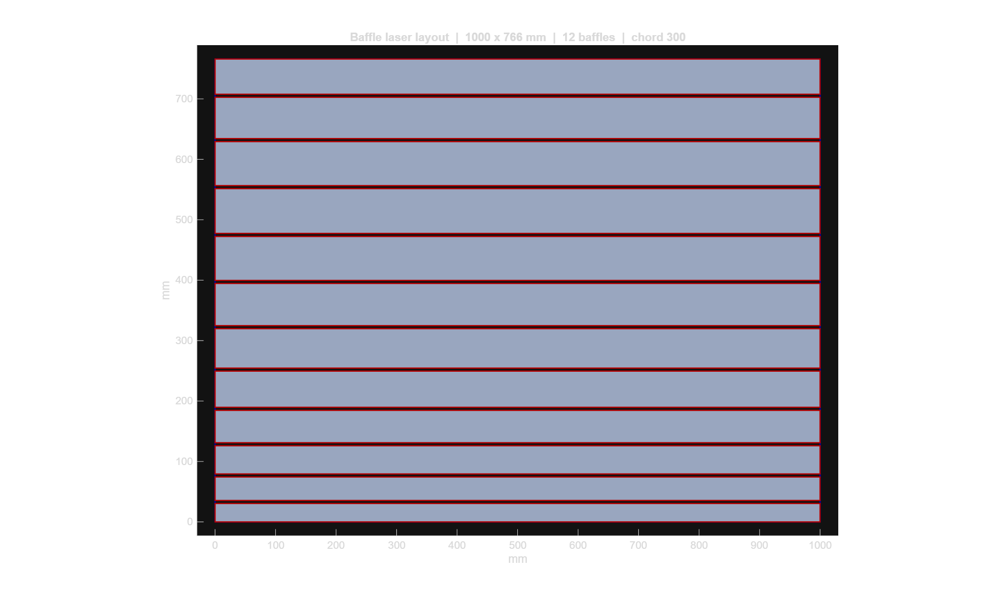</p>

> The converter itself belongs to the lab and is **not** included. The generators read its outputs (`circular_Fabric_length_Upper/Lower`, `baffle_Length`) from the MATLAB workspace or a saved `.mat` file. The previews above are the generated layouts.

## 3. Fabrication

Nylon film is cut on the laser cutter from the generated DXFs. Baffles are then bonded to the skin with a heat-and-pressure (impulse) sealing process. Nylon holds about **3× the inflation pressure of LDPE**, which gives noticeably better aeroelastic stiffness. That's why 5 of the 8 wings were nylon.

<p align="center">
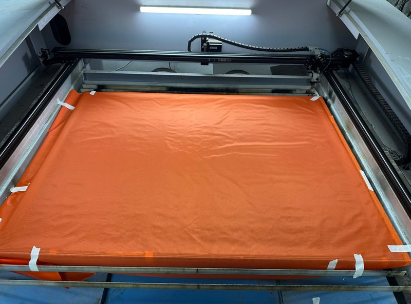 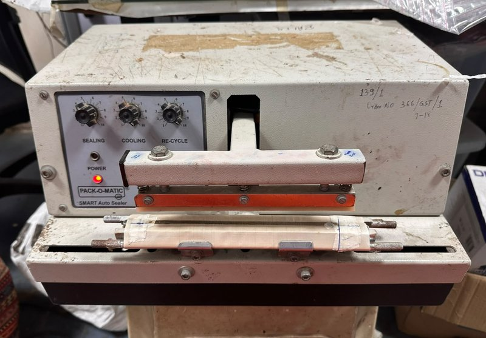 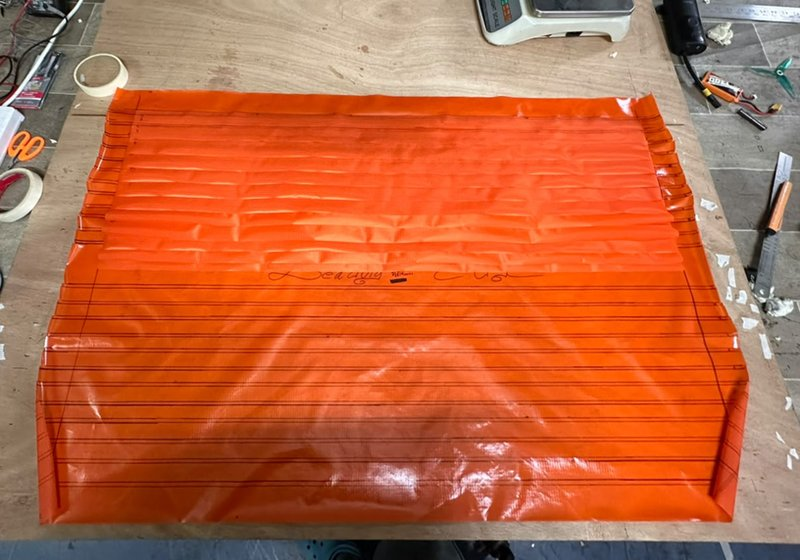
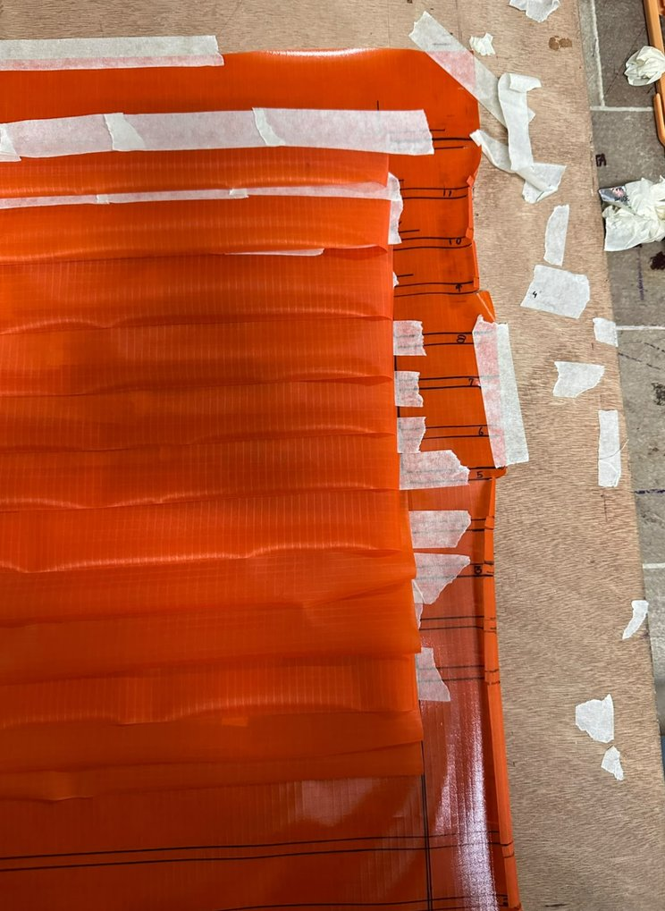 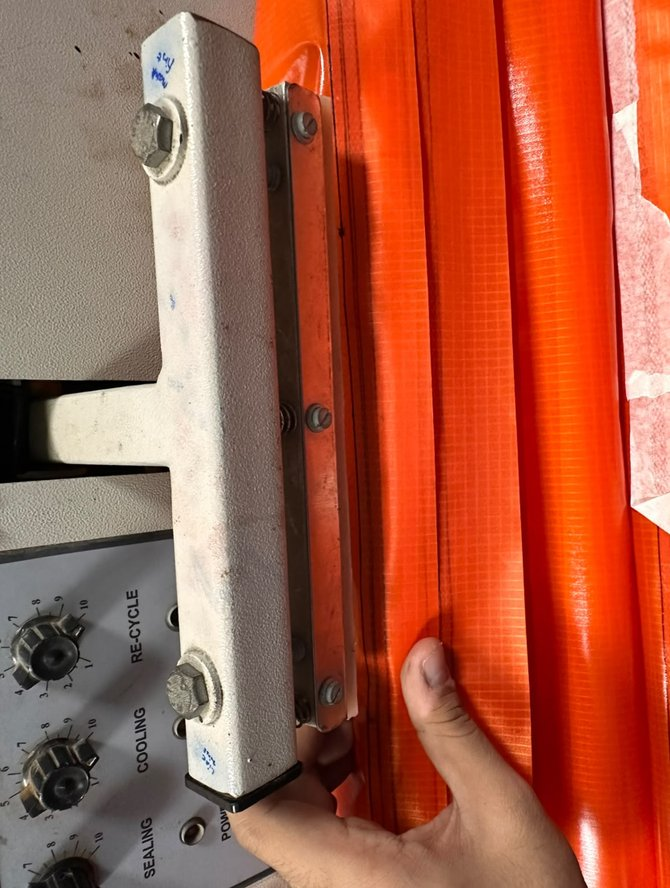 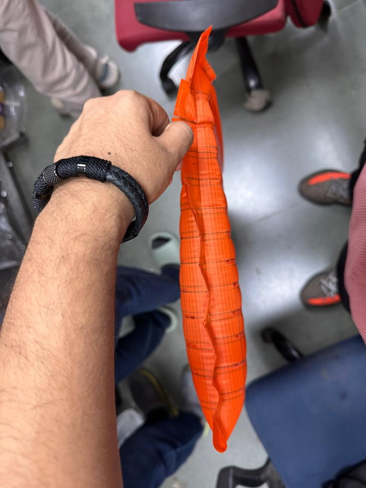
</p>

## 4. CAD: design iterations

Everything was modelled in SOLIDWORKS. Each iteration is published as one STL (click it on GitHub to rotate it in 3D) and one Parasolid `.x_t` (opens in Fusion 360, Onshape, FreeCAD or SOLIDWORKS). The native SOLIDWORKS files are not published.

| Iteration | Model | Configuration |
|---|---|---|
| **itr3 (current)** | [`stl`](cad/itr3_current/uav_itr3.stl) · [`x_t`](cad/itr3_current/uav_itr3.x_t) | **Flown configuration:** 3D-printed hull, motor mount, V-tail mount, servos, battery and X2216 motor |
| itr2 | [`stl`](cad/itr2/uav_itr2.stl) · [`x_t`](cad/itr2/uav_itr2.x_t) | First complete layout: twin booms, V-tail, X2216 motor, servos, battery |
| itr1 | [`stl`](cad/itr1/uav_itr1.stl) · [`x_t`](cad/itr1/uav_itr1.x_t) | First concept: inflated (bumpy) wing and 15-inch prop |

**Parts of the current build** ([`cad/itr3_current/parts`](cad/itr3_current/parts), STL + Parasolid): fuselage hull, motor mount, fuselage shell, V-tail mount, V-tail panel, battery block.

<p align="center">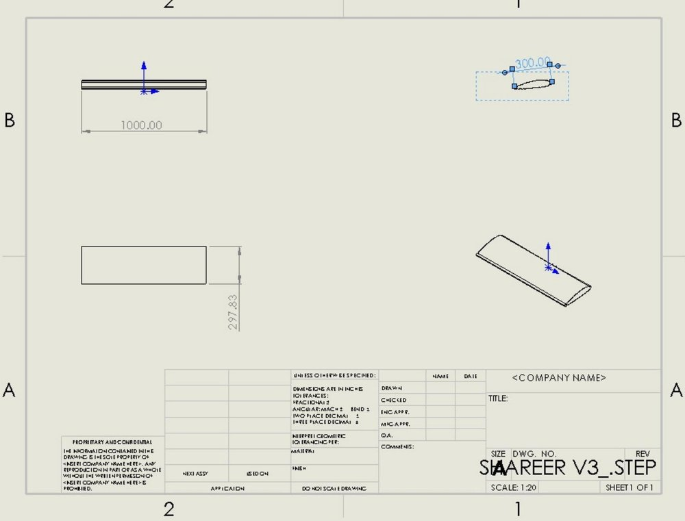 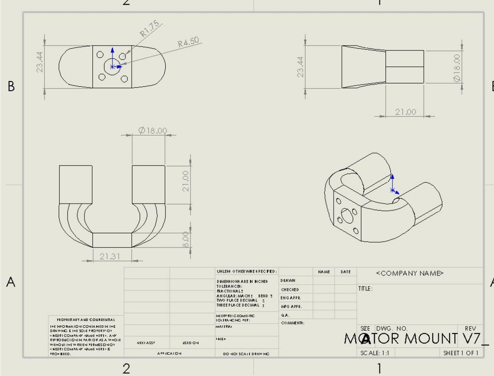 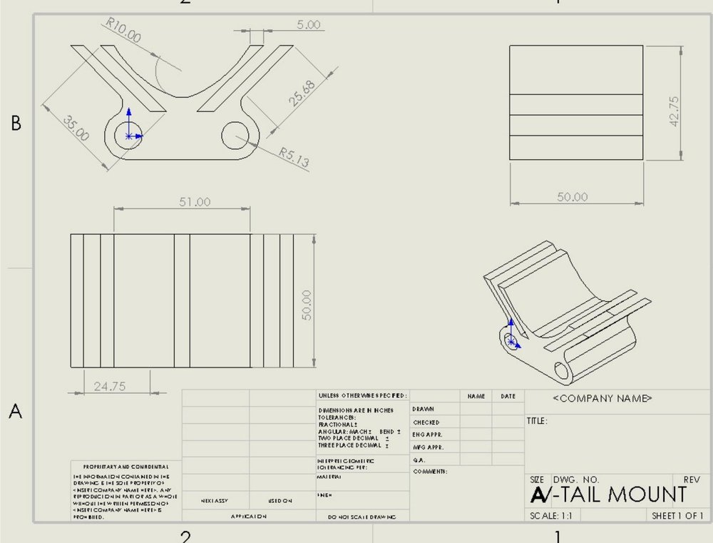 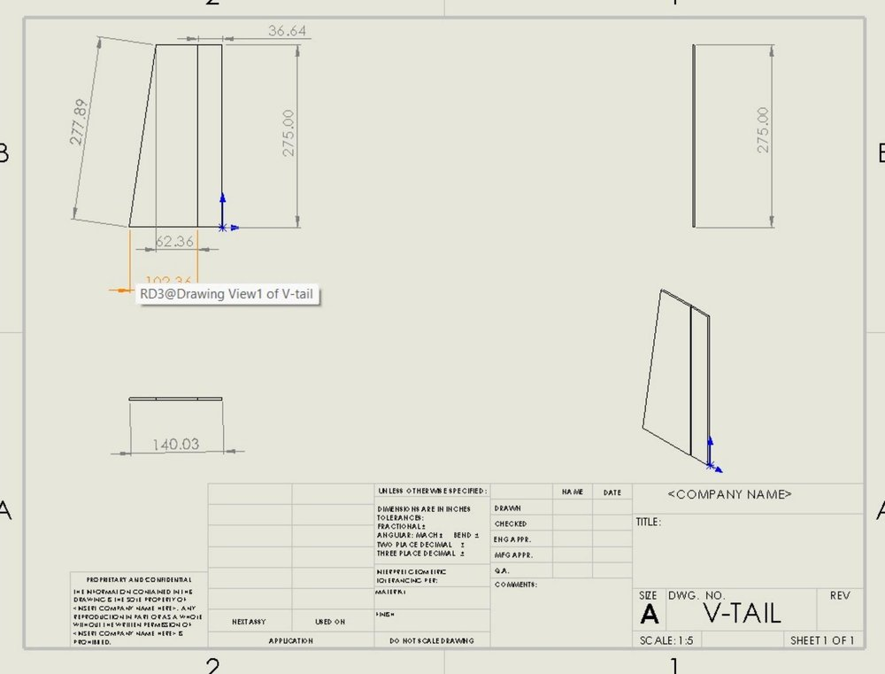</p>

## 5. Assembly & test

<p align="center">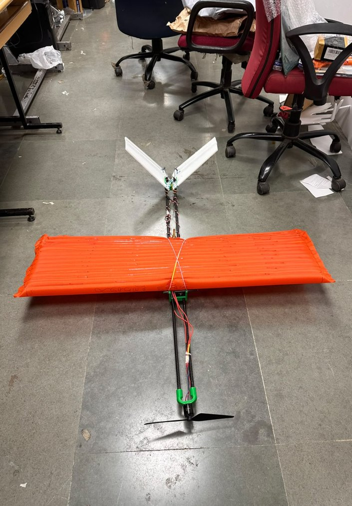 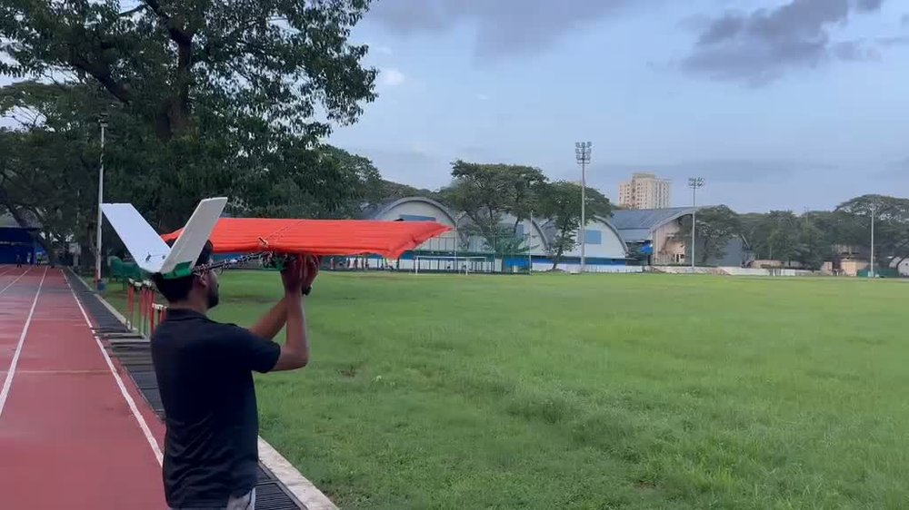 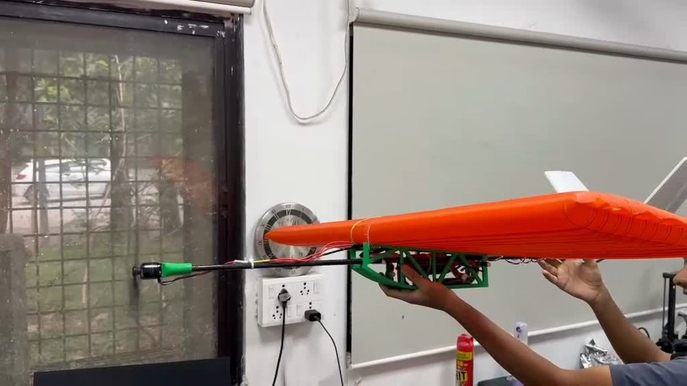</p>

## Repository layout

```
matlab/sizing/      sizing + constraint analysis, layout solver
matlab/laser-cut/   DXF generators for skins and baffles
cad/itr1, itr2, itr3_current   STL + Parasolid of each iteration (itr3 = current)
docs/               formula reference and code flowchart
images/             photos, renders, drawings
```

## Running the code

MATLAB R2018b or newer, with no toolboxes needed. Open `matlab/sizing/uav_sizing.m`, press **Run**, and press Enter to accept each default.

---
*Akshay Malhan · B.E. Mechanical Engineering, Thapar Institute · [LinkedIn](https://linkedin.com/in/akshaymalhan)*
